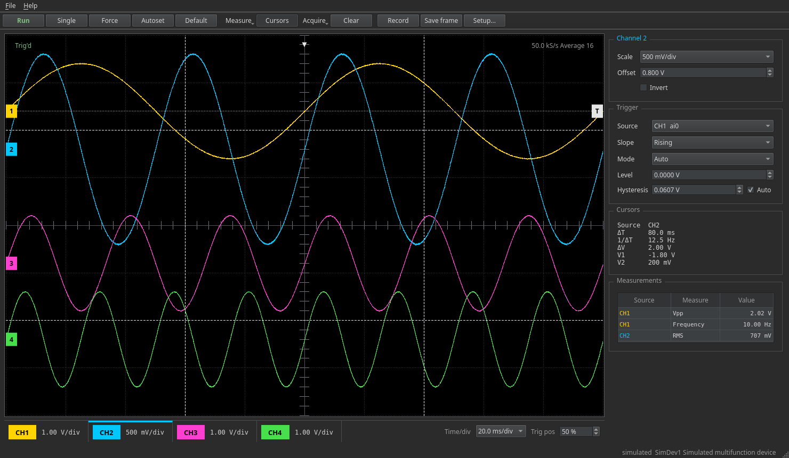

# DAQScope

Oscilloscope front end and acquisition library for NI DAQ devices. Edge trigger, 1-2-5 scales,
cursors, automatic measurements and file recording in the GUI. The same data is available as
numpy arrays from Python. A simulated device is built in, so nothing here needs hardware to run.



Independent project, not affiliated with National Instruments. The NI-DAQmx driver is not
included and must be installed separately.

## Install

Python 3.9+. Use a fresh environment.

```
git clone https://github.com/curlh/DAQScope.git
cd DAQScope
uv sync --extra gui                    # or: pip install -e .[gui]
uv run python -m daqscope              # simulated device
```

Extras: `gui` (PySide6, pyqtgraph), `ni` (nidaqmx), `dev` (pytest).

## NI hardware

Install NI-DAQmx, then `pip install -e .[ni]` in the same environment.

```
python examples/hardware_check.py      # lists devices, reads 1 s from the first AI channel
python -m daqscope --backend nidaqmx
```

The backend targets nidaqmx 1.x. Device enumeration and continuous analog input have been run on
a PCIe-6321 under Windows. Analog output, digital I/O and counters are covered by tests against a
stand-in for the driver and have not been run on hardware yet. Reports with device model and error
text are welcome. On multiplexed cards the aggregate AI rate is shared by the selected channels,
and only rates the card supports for the current selection are offered.

## Scope

The window follows a bench scope. The screen has the channel tiles and the horizontal controls
(time/div, trigger position) underneath. Each tile is a channel key: press it to turn the channel on and select it, press the selected
channel again to turn it off. Scroll over a tile to step its V/div, scroll over the screen to step time/div. The panel on the right shows the menu of the
selected channel and the trigger. Cursors and measurements are off until you switch them on.

- Screen: 10 x 8 divisions, per-channel V/div (1 mV to 5 V), offset in volts and invert, time/div in 1-2-5 steps.
- Trigger: rising or falling edge on any channel, Auto / Normal / Single, draggable level line.
  Hysteresis is derived from the noise on the source (6 sigma of the second difference, capped at
  40 % of the peak-to-peak range) or set by hand. The trigger point is interpolated between
  samples. Auto mode rolls at 100 ms/div and slower.
- Run/Stop, Single, Force trigger, Autoset (V/div, position, trigger level and time/div from the
  signals), Default setup, Clear.
- Acquire: Normal or Average over 4, 16 or 64 triggered frames, aligned on the interpolated trigger point.
- Measure menu: add Vpp, max, min, mean, RMS, frequency, period or duty cycle for the selected
  channel. They appear in a table, right click removes one.
- Cursors: two time and two voltage cursors with delta t, 1/delta t and delta V.
- Display decimation keeps the min and max of every bin, so narrow glitches are not lost.
- Record to CSV (default) or npz on a separate thread. Save frame writes the frame on screen.
  CSV has two `#` comment lines (sample rate, start time) and then a `time_s,<channels>` header,
  so `pandas.read_csv(path, comment="#")` reads it directly.
- Setup: backend, device, inputs and sample rate.
- Keys: F5 run/stop, F6 single, F7 force, F8 autoset, Ctrl+R record, Ctrl+S save frame.

## Python

```python
from daqscope.backends import get_backend
from daqscope.core import AIChannel, AIConfig, AcquisitionSession

backend = get_backend("simulated")                  # or "nidaqmx"
cfg = AIConfig([AIChannel("SimDev1/ai0"), AIChannel("SimDev1/ai1")], sample_rate=10_000)
with AcquisitionSession(backend, cfg) as session:
    data = session.read(10_000)                     # ndarray, shape (2, 10000)
```

Continuous acquisition with recording:

```python
from daqscope.core import StreamRunner
from daqscope.io import open_writer

with AcquisitionSession(backend, cfg) as session:
    runner = StreamRunner(session)                  # worker thread, ring buffer, subscribers
    with open_writer("run.csv", [c.name for c in cfg.channels], cfg.sample_rate) as w:
        runner.subscribe(w.put)
        runner.start()
        ...                                         # runner.buffer.latest(n)
        runner.stop()
```

`daqscope.core.ScopeEngine` holds the trigger and timebase logic and does not depend on Qt.
Analog output, digital lines and counters are exposed by the backend object
(`create_ao`, `create_di`, `create_do`, `create_counter`). See `examples/`.

## Layout

```
src/daqscope/
  core/       sessions, ring buffer, trigger, scope engine, measurements, waveforms
  backends/   interface (base.py), simulated device, NI-DAQmx
  io/         file writers and readers
  gui/        scope window (PySide6, pyqtgraph)
examples/
tests/        pytest, no hardware needed
```

`core` imports neither Qt nor a hardware package. Only `backends/nidaqmx_backend.py` imports
`nidaqmx`, and only `gui/qt.py` selects the Qt binding. A new backend implements the interfaces in
`backends/base.py` and is registered in `backends/__init__.py`.

## Status

Done: analog input scope, simulated device, recording, NI-DAQmx backend.
Not yet: GUI panels for analog output, digital I/O and counters (the backends support them),
sample rate that follows the timebase, hardware input range tied to V/div.

## Development

```
pip install -e .[dev,gui]
pytest
```

The tests use the simulated backend and a fake driver module. `QT_QPA_PLATFORM=offscreen` runs the
GUI without a display. See `CONTRIBUTING.md`.

## License

MIT
